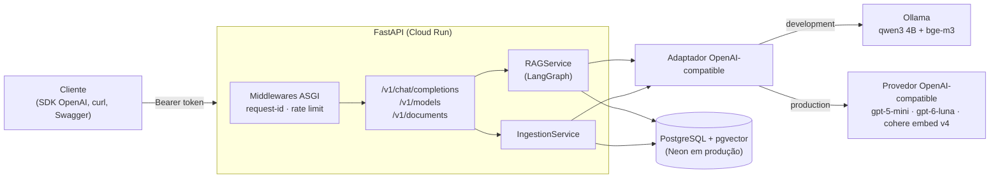
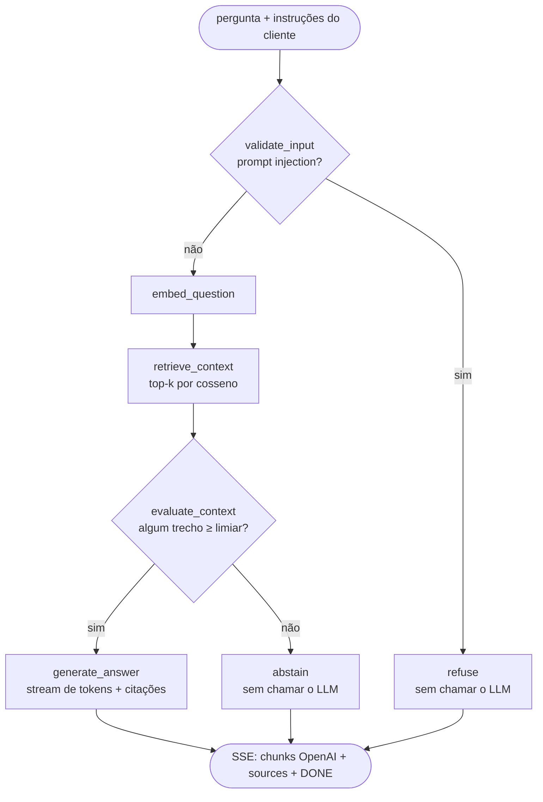
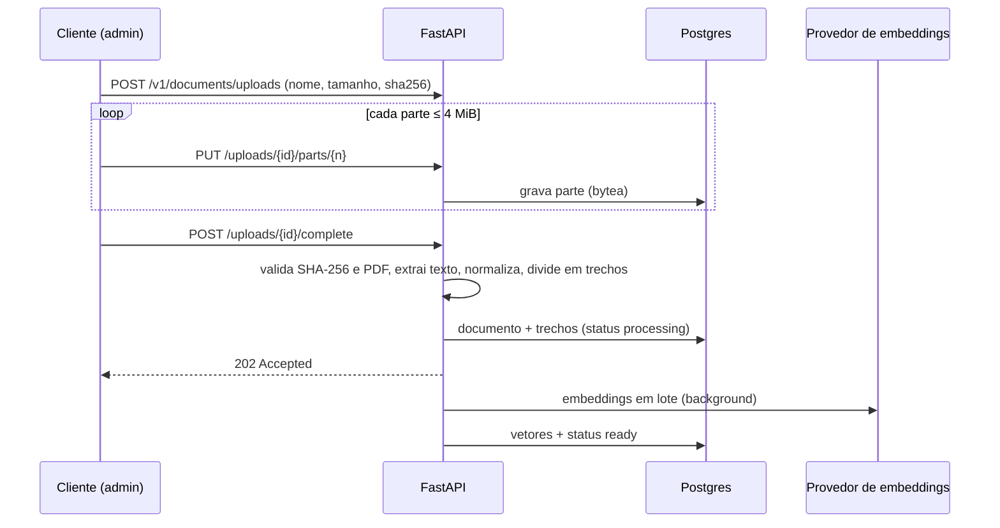

# ChatBot API

API de chatbot com **RAG** (Retrieval-Augmented Generation) que responde perguntas com base em uma base de conhecimento prévia — quatro apostilas de saúde mental na Atenção Primária — usando **Python, FastAPI, LangGraph e PostgreSQL + pgvector**, com contrato **idêntico ao da API da OpenAI** e respostas em **streaming**.

```bash
curl -N https://<sua-api>/v1/chat/completions \
  -H "Authorization: Bearer $API_ACCESS_TOKEN" -H "Content-Type: application/json" \
  -d '{"stream": true, "messages": [{"role": "user", "content": "O que é matriciamento em saúde mental?"}]}'
```

---

## Sumário

- [Funcionalidades](#funcionalidades)
- [Arquitetura](#arquitetura)
- [Base de conhecimento](#base-de-conhecimento)
- [Como executar (Docker)](#como-executar-docker)
- [Usando a API](#usando-a-api)
- [Configuração](#configuração)
- [Qualidade, testes e segurança](#qualidade-testes-e-segurança)
- [Avaliação do RAG (resultados medidos)](#avaliação-do-rag-resultados-medidos)
- [Principais decisões técnicas](#principais-decisões-técnicas)
- [Limitações e próximos passos](#limitações-e-próximos-passos)
- [Como a IA foi usada no desenvolvimento](#como-a-ia-foi-usada-no-desenvolvimento)

---

## Funcionalidades

- **Carga de documentos via API** (upload em partes de até 4 MiB, retomável, com verificação de SHA-256) e via CLI — ambas idempotentes.
- **Recuperação semântica** dos trechos mais relevantes (pgvector, similaridade de cosseno) com **citação de arquivo e páginas**.
- **Geração fundamentada**: o modelo responde só com base nos trechos e cita as fontes `[1]`, `[2]`…
- **Abstenção** quando a base não tem evidência suficiente — sem chamar o LLM.
- **Streaming SSE** no formato da OpenAI; qualquer SDK/cliente OpenAI funciona trocando `base_url` e `api_key`.
- **Seleção de modelo** por allowlist (`GET /v1/models`), sem reescrever a integração.
- **Dois ambientes**: Ollama local em `development`; provedor real apenas em `production`.

---

## Arquitetura



### Fluxo de uma pergunta (grafo LangGraph)



### Ingestão de documentos



Código em `src/chatbot_api/`: `api/` (rotas), `core/` (config, auth, rate limit, erros, logs), `providers/` (adaptador de modelos), `db/` (modelos, migrations), `ingestion/` (PDF → trechos), `uploads/`, `rag/` (retrieval, prompt, grafo) e `evaluation.py`.

---

## Base de conhecimento

Quatro apostilas em PDF sobre **saúde mental na Atenção Primária à Saúde** (APS), fornecidas de forma privada para o desafio — **não são versionadas** (`docs/apostilas/` está no `.gitignore`). Para reproduzir, coloque os PDFs em `docs/apostilas/` ou envie-os pela API.

| Apostila | Páginas | Trechos |
|---|---|---|
| Desenvolvendo os cuidados de saúde mental na APS | 76 | 39 |
| O sujeito, a integralidade e a saúde mental | 53 | 29 |
| Saúde mental na atenção primária | 63 | 44 |
| Unidade 1 — Ampliando o conceito de saúde mental | 65 | 39 |
| **Total** | **257** | **151** |

Temas: conceito ampliado de saúde mental, acolhimento e escuta, integralidade, matriciamento/apoio matricial, RAPS e CAPS, estigma, depressão, ansiedade, uso de álcool, crise e risco de suicídio, determinantes sociais e impactos da pandemia.

**Preparação do texto:** extração por página (pypdf), normalização (o PDF perde as ligaduras "fi"/"fl" — 402 ocorrências como `pro\x00ssionais`, recuperadas por regra medida na própria base), divisão em trechos de ~1500 caracteres por frases inteiras (com sobreposição e rastreio de páginas) e embeddings por modelo. Detalhes no [ADR-0003](docs/ADR/ADR-0003.md).

> As respostas se baseiam exclusivamente nas apostilas e **não substituem avaliação ou atendimento profissional**.

---

## Como executar (Docker)

Pré-requisitos comuns: **Git** e **Docker com Compose v2**. O ambiente local sobe a API, o PostgreSQL + pgvector e o Ollama com os modelos de desenvolvimento (~4 GB de download na primeira vez); não é necessário Python no host.

### Linux

```bash
git clone https://github.com/icarojobs/chatbot-api.git && cd chatbot-api
cp .env.example .env
# Edite o .env: API_ACCESS_TOKEN e API_ADMIN_TOKEN (openssl rand -hex 32) e POSTGRES_PASSWORD
make up                          # ou: docker compose up -d --build
docker compose logs -f ollama-models   # aguarde "success" dos dois modelos
make ingest                      # carrega docs/apostilas na base
```

A API fica em <http://localhost:8000> (Swagger em `/docs`). Com GPU NVIDIA e o [NVIDIA Container Toolkit](https://docs.nvidia.com/datacenter/cloud-native/container-toolkit/install-guide.html): `docker compose -f docker-compose.yml -f docker-compose.gpu.yml up -d`.

### macOS (Intel ou Apple Silicon)

1. Instale o [Docker Desktop](https://www.docker.com/products/docker-desktop/) e reserve **≥ 8 GB de memória** em *Settings → Resources*.
2. No Terminal, siga os mesmos comandos do Linux (`make` já vem com as Command Line Tools; sem `make`, use os comandos `docker compose` equivalentes do `Makefile`).
3. O Ollama em container roda em CPU no macOS (sem acesso à GPU do Apple Silicon); as respostas em dev ficam mais lentas.

### Windows (WSL2)

1. Instale o WSL2 com Ubuntu (`wsl --install` no PowerShell como administrador) e o [Docker Desktop](https://www.docker.com/products/docker-desktop/) com *Use the WSL 2 based engine* e a integração com a distribuição Ubuntu ativadas.
2. Abra o terminal **do Ubuntu** e clone o projeto **dentro do sistema de arquivos Linux** (ex.: `~/projetos`), não em `/mnt/c` — o I/O é muito mais rápido.
3. `sudo apt install make` e siga os comandos do Linux.
4. GPU NVIDIA no WSL2: driver NVIDIA recente no Windows + override `docker-compose.gpu.yml`.

### Portas ocupadas?

Ajuste `API_HOST_PORT`, `POSTGRES_HOST_PORT` e `OLLAMA_HOST_PORT` no `.env`.

### Produção

Deploy no **Google Cloud Run + Neon** com `make deploy` — passo a passo em [docs/hospedagem/DEPLOY.md](docs/hospedagem/DEPLOY.md).

---

## Usando a API

| Método | Rota | Token | Descrição |
|---|---|---|---|
| `GET` | `/health`, `/ready` | — | Liveness e readiness (inclui o banco) |
| `GET` | `/v1/models` | acesso | Modelos do ambiente (formato OpenAI) com `type`: `chat` (gera respostas) ou `embedding` (busca do RAG) |
| `POST` | `/v1/chat/completions` | acesso | Pergunta/resposta com RAG, `stream` opcional |
| `POST` | `/v1/documents?filename=…` | admin | Upload direto de um PDF (até 30 MB, corpo binário) |
| `POST` | `/v1/documents/uploads` (+ `parts`, `complete`) | admin | Upload em partes de PDFs |
| `DELETE` | `/v1/documents/{id}` | admin | Remove um documento (trechos e embeddings juntos) |
| `DELETE` | `/v1/documents?confirm=true` | admin | Reset: remove todos os documentos (desabilitado em produção por padrão) |
| `GET` | `/v1/documents`, `/v1/documents/{id}` | admin | Documentos e status da ingestão |

Com o SDK oficial da OpenAI:

```python
from openai import OpenAI

client = OpenAI(base_url="http://localhost:8000/v1", api_key="<API_ACCESS_TOKEN>")
stream = client.chat.completions.create(
    model=client.models.list().data[0].id,
    messages=[{"role": "user", "content": "Como acolher um usuário em sofrimento psíquico?"}],
    stream=True,
)
for chunk in stream:
    if chunk.choices and chunk.choices[0].delta.content:
        print(chunk.choices[0].delta.content, end="", flush=True)
```

O último chunk traz os campos extras `sources` (arquivo, páginas e score de cada trecho citado) e `abstained`. Manual completo, com upload e erros: [docs/manuais/MANUAL_DA_API.md](docs/manuais/MANUAL_DA_API.md). Para testar pelo Postman, importe [docs/postman/chatbot-api.postman_collection.json](docs/postman/chatbot-api.postman_collection.json) e siga [docs/manuais/TESTE_COM_POSTMAN.md](docs/manuais/TESTE_COM_POSTMAN.md).

---

### Alternar entre desenvolvimento e produção (local)

No Docker, quem escolhe o ambiente é o `make`, não o `API_ENV` do `.env`. O container ignora esse valor para evitar uma combinação inválida: modelos de produção com o banco que só tem embeddings de desenvolvimento, o que faria toda pergunta cair em abstenção.

| Comando | Modelos | Banco local | Observação |
|---|---|---|---|
| `make up` | Ollama (`qwen3` + `bge-m3`) | `POSTGRES_DB` (ex.: `chatbot`) | Padrão, sem custo |
| `make up-prod` | Provedor real (`OPENAI_*` do `.env`) | `chatbot_prod`, criado se não existir | **Gasta créditos** a cada pergunta |

- **Primeira vez em produção local:** rode `make ingest-prod-local` para gerar os embeddings de produção no banco `chatbot_prod`. Isso **gasta créditos**; a base atual usa cerca de 55 mil tokens.
- **Troca de ambiente:** basta rodar o outro comando. Só o container da API é recriado (em segundos), e os dois bancos coexistem.
- **Por que não basta `restart`:** o `docker compose restart` não relê o `.env`; o container precisa ser recriado.

## Configuração

Todas as variáveis estão documentadas no [`.env.example`](.env.example). As principais:

| Variável | Descrição |
|---|---|
| `API_ENV` | `development` (Ollama, padrão) ou `production` (provedor real). Vale para `make run`/CLI no host; no Docker, use `make up` / `make up-prod` |
| `API_ACCESS_TOKEN` / `API_ADMIN_TOKEN` | Tokens Bearer (mín. 32 caracteres) de consumo e de administração |
| `DATABASE_URL` | PostgreSQL com pgvector (`postgresql+psycopg://…`) |
| `OPENAI_BASE_URL`, `OPENAI_ACCESS_KEY` | Endpoint e chave do provedor de produção (nunca versionados) |
| `OPENAI_RESPONSE_MODELS` / `OPENAI_EMBEDDINGS_MODELS` | Allowlist de modelos (o primeiro é o padrão) |
| `RAG_MIN_SCORE` | Override do limiar de similaridade (vazio = valor calibrado por modelo) |
| `RATE_LIMIT_DEFAULT`, `TRUSTED_PROXY_HOPS` | Rate limit por IP e proxies confiáveis |
| `CORS_ALLOWED_ORIGINS` | Origens liberadas no CORS, separadas por vírgula (padrão `*`, qualquer origem) |

Segredos ficam apenas no `.env` (local) ou no Secret Manager (produção).

---

## Qualidade, testes e segurança

```bash
make install   # uv sync (Python 3.14 + dependências fixadas no uv.lock)
make check     # ruff + mypy strict + pytest (cobertura mínima de 95%)
make evaluate  # avaliação do retrieval
make redteam   # 16 ataques de prompt injection contra os modelos do ambiente (make up / make up-prod)
```

- **206 testes, 100% de cobertura**, com warnings tratados como erro. Testes de integração usam PostgreSQL real; nenhum teste chama provedores reais.
- O endpoint de chat é testado com o **SDK oficial da OpenAI** contra a API.
- **CI** (`ci.yml`): lint, tipos e testes com Postgres em todo PR.
- **Security** (`security.yml`): CodeQL, Semgrep, pip-audit, Gitleaks e Trivy bloqueiam o merge em achados HIGH/CRITICAL ([RFC-0001](docs/RFC/RFC-0001.md)).
- **Prompt injection** ([ADR-0008](docs/ADR/ADR-0008.md)), defesa em camadas:
  - filtro determinístico que recusa sem chamar o LLM;
  - descarte de trechos de PDF envenenados;
  - blocos delimitados e higienizados;
  - prompt com regras fixas.

  Medido com `make redteam`:

  | Ambiente | Antes | Depois |
  |---|---|---|
  | dev (`qwen3:4b`) | 8/13 | 15/16 |
  | prod (`gpt-5-mini`) | — | 16/16 |
- Controles da aplicação: tokens comparados em tempo constante, rate limit em todas as rotas (IP real atrás do proxy), allowlist de modelos, erros sem detalhes internos, contexto tratado como dado não confiável no prompt, uploads validados por SHA-256 e magic bytes, container sem root e segredos fora do repositório.

---

## Avaliação do RAG (resultados medidos)

Conjunto versionado em [`evaluation/questions.json`](evaluation/questions.json): 20 perguntas sobre as apostilas e 10 fora do escopo ([ADR-0006](docs/ADR/ADR-0006.md)).

| Métrica (top-4) | Desenvolvimento (`bge-m3`) | Produção (`cohere/embed-v4.0`) |
|---|---|---|
| Hit@4 (recall) | 85% | **90%** |
| MRR | 0,767 | **0,817** |
| Perguntas no escopo respondidas | 95% | 95% |
| Abstenção correta fora do escopo | 100% | 100% |
| Latência do retrieval | 3,6 ms | 3,5 ms |

Ponta a ponta em produção (`gpt-5-mini`): respostas com citações corretas em 5–10 s até o primeiro token (modelo de raciocínio); perguntas fora do escopo abstêm em < 1 s.

---

## Principais decisões técnicas

| Decisão | Por quê | Registro |
|---|---|---|
| Contrato idêntico ao da OpenAI | Qualquer SDK/cliente funciona sem adaptação | [RFC-0002](docs/RFC/RFC-0002.md) |
| Um único adaptador OpenAI-compatible (Ollama e produção) | Trocar de modelo/ambiente é só configuração | [ADR-0002](docs/ADR/ADR-0002.md) |
| PostgreSQL + pgvector, vetores por modelo de embedding | Durável no Cloud Run; dev (1024 dim) e prod (1536 dim) convivem | [ADR-0003](docs/ADR/ADR-0003.md) |
| Busca exata, sem HNSW | 151 trechos: milissegundos e recall de 100% do índice | [ADR-0003](docs/ADR/ADR-0003.md) |
| LangGraph com abstenção determinística | Responder/abster explícito e testável; abstenção sem custo de LLM | [ADR-0004](docs/ADR/ADR-0004.md) |
| Limiar calibrado por modelo de embedding | Com o limiar do dev, produção teria 30% de abstenções indevidas | [ADR-0006](docs/ADR/ADR-0006.md) |
| CORS liberado para qualquer origem (configurável) | Front-ends e páginas de teste chamam a API direto do navegador; sem cookies, o Bearer no header mantém o `*` seguro | [ADR-0009](docs/ADR/ADR-0009.md) |
| `system`/`developer` como instruções do cliente | Compatível com a OpenAI (tom, formato, idioma) sem burlar as regras do RAG; resposta no idioma da pergunta | [ADR-0007](docs/ADR/ADR-0007.md) |
| Defesa em camadas contra prompt injection + red team | O prompt sozinho bloqueava 8/13 ataques no modelo de dev; com as camadas determinísticas, 15/16 (dev) e 16/16 (prod) | [ADR-0008](docs/ADR/ADR-0008.md) |
| Upload em partes de 4 MiB no Postgres | Funciona em qualquer hospedagem, retomável e multi-instância | [Fase 4](docs/planejamento/PLANO_DE_DESENVOLVIMENTO.md) |
| Rate limit e logs em middlewares ASGI próprios | A slowapi não aplicava o limite e quebraria o streaming SSE | [ADR-0001](docs/ADR/ADR-0001.md) |
| Cloud Run + Neon | SSE, 32 MiB por requisição, sem cold start na avaliação | [ADR-0005](docs/ADR/ADR-0005.md) |

O desenvolvimento seguiu o [plano por fases](docs/planejamento/PLANO_DE_DESENVOLVIMENTO.md), com um PR por fase descrevendo o que foi feito, os motivos e os trade-offs.

---

## Limitações e próximos passos

- **Histórico de conversa** não é usado na busca (apenas a última pergunta).
- **Prompt injection**: o filtro é baseado em padrões e o modelo de dev (4B) ainda obedece a ordens disfarçadas. Em produção, os 16 ataques foram bloqueados, mas nenhuma defesa é absoluta. Rode `make redteam` a cada troca de modelo ou de prompt.
- **Recall de 90%**: termos raros com uma única ocorrência (ex.: "redução de danos") podem ficar fora do top-4 → busca híbrida (BM25 + RRF) se a base crescer.
- **Rate limit por instância** (memória); Redis se houver várias instâncias sob carga.
- **Ingestão em background no processo**: um restart durante os embeddings exige reenviar o documento (a ingestão retoma de onde parou).
- **PDFs digitalizados** (sem texto) não são suportados (sem OCR).
- **`usage`** (contagem de tokens) não é retornado nas respostas.
- **Avaliação** pequena (30 perguntas, relevância por termos): adequada para regressão e calibração, não como benchmark absoluto.

---

## Como a IA foi usada no desenvolvimento

O projeto foi conduzido por **icarojobs como Arquiteto de Software**, com a IA (**Claude Code CLI + Claude Opus 5.5**) gerando código, testes e documentação:

- **Arquitetura e decisões**: cada etapa começou com uma RFC de perguntas de múltipla escolha com recomendação; as escolhas finais foram do arquiteto e estão registradas em `docs/RFC/` e `docs/ADR/`.
- **Implementação**: a IA escreveu o código e os testes de cada fase, em micro-commits semânticos e um PR por fase, revisados antes do merge.
- **Validação com dados reais, não só testes**: smoke tests contra o provedor e o Ollama revelaram que o `gpt-5-mini` devolvia respostas vazias com limite baixo de tokens, que o `qwen3:4b` com raciocínio levava 253 s até o primeiro token em CPU e que o PDF perdia ligaduras "fi"/"fl" — todos corrigidos e documentados.
- **Bugs encontrados na validação**: a slowapi não aplicava o limite e quebraria o SSE; a reingestão sem pendências marcava documentos como falhos; um teste dependia do `.env` local; o limiar de similaridade do dev causaria 30% de abstenções em produção.
- **Regras de projeto** (`CLAUDE.md` / `docs/COMPORTAMENTO_DA_IA.md`): versões fixadas, cobertura ≥ 95%, segredos fora do git, rate limit em todos os endpoints, UI em pt-br e código em en-us.

---

## Licença

[MIT](LICENSE)
