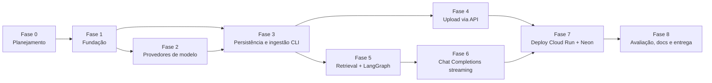

# Plano de desenvolvimento — ChatBot API

- **Prazo de entrega:** sexta-feira, 30/10/2026
- **Decisões de base:** [RFC-0002](../RFC/RFC-0002.md)
- **Regra de entrega:** **1 PR por fase**, com micro-commits semânticos e descrição em pt-br seguindo o [template de PR](../../.github/pull_request_template.md) (o que foi feito, por que, trade-offs, como testar).

---

## Visão geral

| Fase | Entrega | Prioridade | Data-alvo |
|---|---|---|---|
| 0 | Plano, RFC-0002, template de PR | — | 27/10 |
| 1 | Projeto executável: app FastAPI, config, auth, rate limit, Docker, CI leve | P0 | 27/10 |
| 2 | Adaptadores LLM/embeddings (Ollama em dev, provedor real em prod) + `GET /v1/models` | P0 | 28/10 |
| 3 | Postgres + pgvector, migrations, pipeline de ingestão e CLI | P0 | 28/10 |
| 4 | Upload de documentos em partes via API | P0 | 28/10 |
| 5 | Retrieval, avaliação de suficiência e grafo LangGraph | P0 | 29/10 |
| 6 | `POST /v1/chat/completions` compatível com OpenAI (streaming SSE) | P0 | 29/10 |
| 7 | Deploy público (Cloud Run + Neon) | P0 | 29/10 |
| 8 | Avaliação do retrieval, README final, manual, reativar Security | P1/P2 | 30/10 |

O deploy (Fase 7) vem antes do polimento de propósito: validar a plataforma cedo evita surpresas na véspera da entrega.

### Regras que valem para todas as fases

- Cobertura de testes ≥ 95% (gate no `make check` e na CI); nenhuma chamada real a provedores nos testes.
- Todo endpoint com rate limiting; endpoints que consomem créditos exigem Bearer token.
- Versões pinadas (nunca `latest`); segredos só no `.env`, com exemplo no `.env.example`.
- Código/infra em en-us; mensagens ao usuário, docs e PRs em pt-br.
- Mudanças de arquitetura geram ADR em `docs/ADR/`; todo endpoint novo atualiza o manual em `docs/manuais/`.
- Nenhuma menção à IA como coautora em commits/PRs.

---

## Fase 0 — Planejamento

**Escopo:** este documento, [RFC-0002](../RFC/RFC-0002.md), template de PR, README e `CLAUDE.md` alinhados às decisões (Python 3.14, Postgres, Ollama).

**Por quê:** README, `CLAUDE.md` e o rascunho em `playground/` divergiam em contrato da API, ingestão, persistência e versão do Python. Fixar as decisões antes do código evita retrabalho com prazo curto.

---

## Fase 1 — Fundação

**Escopo**
- `.mcp.json` na raiz (pré-requisito obrigatório das regras do projeto antes de qualquer código).
- Atualizar o uv local (0.5.9 → 0.13.x); `pyproject.toml` com Python 3.14.x, layout `src/chatbot_api/`, `uv.lock`.
- Configuração tipada com `pydantic-settings` (valida `.env` no startup; falha rápido se faltar variável em produção).
- App factory FastAPI com lifespan (clientes criados uma vez e fechados no shutdown), `GET /health` e `GET /ready`.
- Autenticação Bearer (`API_ACCESS_TOKEN` para chat, `API_ADMIN_TOKEN` para upload), comparação em tempo constante.
- Rate limiting global com `slowapi`, limites configuráveis por rota.
- Handler de erros padronizado no formato de erro da OpenAI (`{"error": {"message", "type", "code"}}`), sem stack trace.
- Logs estruturados em JSON com `request_id` (sem prompts, documentos ou segredos).
- `Makefile`: `sync`, `run`, `test`, `lint`, `check` (ruff + mypy + pytest com `--cov-fail-under=95`).
- `Dockerfile` multi-stage (usuário não-root) e `docker-compose.yml` com `api`, `postgres` (pgvector) e `ollama` (GPU).
- Workflow `ci.yml` leve: ruff, mypy, pytest com cobertura (~1 min por PR).

**Por quê:** tudo o que vem depois depende de config, auth, rate limit, tratamento de erro e do ciclo de testes. Fazer isso primeiro torna cada fase seguinte só "regra de negócio".

**Trade-offs**
- Rate limit em memória do processo: simples e sem dependências, mas o limite vale por instância. Aceitável com poucas instâncias no Cloud Run; Redis só se houver necessidade comprovada.
- Token estático em vez de usuários/JWT: cabe no prazo e é exatamente o que SDKs OpenAI enviam como `api_key`; não há revogação por usuário.

**ADR:** ADR-0001 — Stack, layout do projeto e Python 3.14.

---

## Fase 2 — Provedores de modelo

**Escopo**
- Contratos `ChatModelProvider` e `EmbeddingProvider` (Protocols) — o resto do código nunca importa o SDK diretamente.
- Uma única implementação `OpenAICompatibleProvider` usando o SDK `openai`: em `development` aponta para o Ollama (`/v1`), em `production` para o provedor real. Só muda `base_url`, chave e modelos.
- Registro de modelos por ambiente (allowlist): dev = `qwen3:4b` (chat) + `bge-m3` (embeddings); prod = modelos de `OPENAI_RESPONSE_MODELS` / `OPENAI_EMBEDDINGS_MODELS`.
- Mapeamento opcional de alias para o cliente poder usar o mesmo nome de modelo nos dois ambientes.
- `GET /v1/models` no formato da OpenAI (`{"object": "list", "data": [...]}`), listando só os modelos configurados.
- Tradução de erros do provedor (timeout, 429, 5xx) para erros públicos seguros; timeout e 1 retry.
- Script de smoke test em `playground/` para validar o endpoint real uma única vez: dimensão do embedding, streaming e parâmetros aceitos.

**Por quê:** o requisito "trocar de modelo sem reescrever a integração" se resolve com uma única abstração. Como o Ollama já expõe API compatível com a OpenAI, dev e prod usam o mesmo código; nada de branch por ambiente.

**Trade-offs**
- Embeddings de dev (`bge-m3`, 1024 dimensões) e prod (`cohere/embed-v4.0`) **não são comparáveis**: o índice fica separado por modelo de embedding, e a qualidade do retrieval em dev não prova a de prod.
- `qwen3:4b` responde bem em pt-br, mas é bem inferior aos modelos de prod; serve para o fluxo, não para avaliar a qualidade das respostas.

**ADR:** ADR-0002 — Provedores compatíveis com OpenAI e ambientes dev/prod.

---

## Fase 3 — Persistência e ingestão (CLI)

**Escopo**
- PostgreSQL + pgvector com SQLAlchemy 2 (async, `psycopg`) e migrations Alembic.
- Tabelas: `documents` (nome, hash SHA-256, status, páginas), `chunks` (texto, página, índice, hash) e `chunk_embeddings` (chunk, `embedding_model`, vetor).
- Índice HNSW (cosseno) **parcial por modelo de embedding**, permitindo dimensões diferentes entre dev e prod na mesma tabela.
- Pipeline: extrair texto por página (`pypdf`) → normalizar → chunking por tokens (~500 com sobreposição de ~75, respeitando parágrafos e página) → embeddings em lotes → persistir em transação.
- Idempotência: documento com mesmo hash e mesmo modelo de embedding não é reprocessado.
- CLI `uv run python -m chatbot_api.ingest docs/apostilas` para carregar as 4 apostilas.

**Por quê:** o Cloud Run tem disco efêmero; ingestão via API exige armazenamento durável e compartilhado entre instâncias. O pgvector também resolve filtros por metadados e evita manter um índice próprio em memória.

**Trade-offs**
- Um serviço a mais (Postgres) e migrations, contra um índice NumPy local — mais setup, em troca de durabilidade e concorrência corretas.
- Parâmetros de chunking são hipótese inicial; a Fase 8 mede e ajusta.
- PDFs digitalizados sem texto extraível (OCR) ficam fora do escopo.

**ADR:** ADR-0003 — PostgreSQL + pgvector como armazenamento vetorial.

---

## Fase 4 — Upload de documentos via API

**Escopo**
- Upload em partes (resumable), protegido pelo token admin:
  - `POST /v1/documents/uploads` → cria a sessão (nome, tamanho total, hash esperado).
  - `PUT /v1/documents/uploads/{id}/parts/{n}` → envia cada parte (≤ 4 MB).
  - `POST /v1/documents/uploads/{id}/complete` → valida tamanho e hash, monta o arquivo e dispara a ingestão.
  - `GET /v1/documents` e `GET /v1/documents/{id}` → status (`pending`, `processing`, `ready`, `failed`).
- Partes guardadas no Postgres (sobrevivem a restart e funcionam com várias instâncias); limpeza das sessões expiradas.
- Validações: só PDF (magic bytes, não só extensão), tamanho máximo, número de partes e rate limit específico.
- A ingestão reaproveita o pipeline da Fase 3 (mesmo código da CLI), executada em background.

**Por quê:** o README exige carregar documentos via API, e o `DECISAO_TECNICA.md` define upload em partes para não depender do limite de requisição de nenhuma hospedagem (4,5 MB na Vercel, 32 MiB no Cloud Run).

**Trade-offs**
- Processamento em background no próprio processo (sem fila): simples, mas exige Cloud Run com CPU sempre alocada e um job interrompido por restart precisa ser reenviado (o status fica `failed`/`processing` detectável). Fila (Cloud Tasks/Celery) só se o volume justificar.
- Partes em `bytea` no Postgres ocupam espaço do plano free do Neon; são apagadas logo após a ingestão.

---

## Fase 5 — Retrieval e orquestração com LangGraph

**Escopo**
- Busca vetorial top-k (cosseno via pgvector) filtrando pelo modelo de embedding ativo.
- `evaluate_context` determinístico: score mínimo e orçamento máximo de contexto (caracteres/tokens), sem LLM extra.
- Prompt com guardrails: responde só com base nas fontes, em pt-br, trata documentos como dados não confiáveis (mitiga prompt injection), cita as fontes e avisa que não substitui atendimento profissional de saúde mental.
- `StateGraph` com os nós `validate_input → embed_question → retrieve_context → evaluate_context → (generate_answer | abstain) → finalize`; dependências injetadas.
- Tokens emitidos via stream customizado do LangGraph; o estado interno nunca chega ao cliente.

**Por quê:** a decisão "responder ou se abster" é o coração do RAG confiável; o grafo deixa esse desvio explícito e testável nó a nó.

**Trade-offs**
- LangGraph adiciona dependência e curva de aprendizado para um fluxo pequeno; em troca, ganha-se testabilidade por nó e espaço para evoluir (reranking, busca híbrida) sem reescrever.
- Threshold de suficiência calibrado empiricamente: rígido demais gera abstenção excessiva; frouxo demais, alucinação. A Fase 8 mede.

---

## Fase 6 — Chat Completions compatível com OpenAI

**Escopo**
- `POST /v1/chat/completions` aceitando o payload da OpenAI (`model`, `messages`, `stream`, `max_tokens`, `temperature`); a pergunta é a última mensagem `user`.
- `stream: true` → SSE com chunks `chat.completion.chunk` e `data: [DONE]`; `stream: false` → `chat.completion`.
- Campo extra `sources` (documento, página, chunk) no último chunk/resposta — clientes OpenAI ignoram campos desconhecidos.
- Falha após o início do stream → chunk de erro seguro + encerramento; desconexão do cliente cancela a geração no provedor.
- Cabeçalhos `Cache-Control: no-cache` e `X-Accel-Buffering: no`.
- Testes de integração com provedor falso: múltiplos chunks, `sources`, abstenção, erro do provedor, cancelamento.
- Manual de uso em `docs/manuais/` com exemplos em `curl` e com o SDK `openai` em Python.

**Por quê:** "formato de chamada idêntico ao da API da OpenAI" significa que qualquer cliente existente (SDKs, LangChain, Open WebUI) funciona só trocando `base_url` e `api_key`.

**Trade-offs**
- Histórico multi-turno não é usado no retrieval no MVP (só a última pergunta), o que mantém o contexto previsível e barato; perguntas que dependem do turno anterior podem perder contexto.
- Parâmetros OpenAI não suportados (`tools`, `n > 1`, `logprobs`) retornam erro 400 explícito em vez de serem ignorados silenciosamente.

---

## Fase 7 — Deploy (Cloud Run + Neon)

**Escopo**
- Neon Postgres (free) com pgvector; migrations aplicadas no deploy.
- Imagem no Artifact Registry; Cloud Run com `min-instances=1` (sem cold start durante a avaliação), CPU sempre alocada (ingestão em background) e timeout compatível com streaming.
- Segredos no Secret Manager (chave do provedor, tokens da API, URL do banco).
- Ingestão das 4 apostilas em produção com o modelo de embedding real.
- Smoke test na URL pública: `/health`, `/ready`, `/v1/models` e streaming de ponta a ponta.

**Por quê:** a análise em `docs/hospedagem/DECISAO_TECNICA.md` escolheu o Cloud Run (32 MiB por requisição, SSE, free tier); Render foi descartado por suspensão e disco efêmero.

**Trade-offs**
- `min-instances=1` com CPU sempre alocada **pode sair do free tier** (custo baixo, mas não zero); o alternativo é aceitar cold start de alguns segundos.
- Neon free suspende o banco após inatividade; a primeira consulta após a suspensão leva ~1 s a mais.

**ADR:** ADR-0004 — Hospedagem em Cloud Run + Neon.

---

## Fase 8 — Avaliação, documentação e entrega

**Escopo**
- Conjunto versionado de perguntas sobre as apostilas (com páginas esperadas e perguntas fora da base); medir Recall@4, taxa de abstenção correta, presença de fontes, TTFT e latência total.
- Ajuste de chunking/threshold com base nas medições (busca híbrida/reranking só se os números mostrarem necessidade).
- README final: arquitetura em mermaid, base de conhecimento, decisões técnicas, resultados medidos, limitações, uso da IA no desenvolvimento e passo a passo com Docker em Linux, macOS e Windows WSL2.
- Manual completo da API em `docs/manuais/`.
- Reativar o workflow Security (`gh workflow enable Security`) e corrigir o que ele apontar.

**Por quê:** o diferencial da entrega é provar, com números, que o sistema recupera as fontes certas e se abstém quando deve — e documentar honestamente o que foi medido.

---

## Critérios de aceite da entrega

- [ ] Instala a partir do `uv.lock` em ambiente limpo e sobe com `docker compose up`.
- [ ] As 4 apostilas são ingeridas (CLI e API), com fontes rastreáveis até a página.
- [ ] Reingestão de documento inalterado não recalcula embeddings.
- [ ] Modelo selecionável por allowlist via `GET /v1/models` + campo `model`.
- [ ] Resposta chega progressivamente via SSE no formato da OpenAI, com `sources`.
- [ ] A API se abstém quando não há evidência suficiente.
- [ ] Erros não expõem segredos nem stack traces; desconexão encerra o stream.
- [ ] Todos os endpoints com rate limit; chat e upload exigem token.
- [ ] Cobertura ≥ 95% sem chamadas reais a provedores.
- [ ] URL pública testada fora do ambiente local.
- [ ] Nenhuma chave ou apostila no repositório público.
